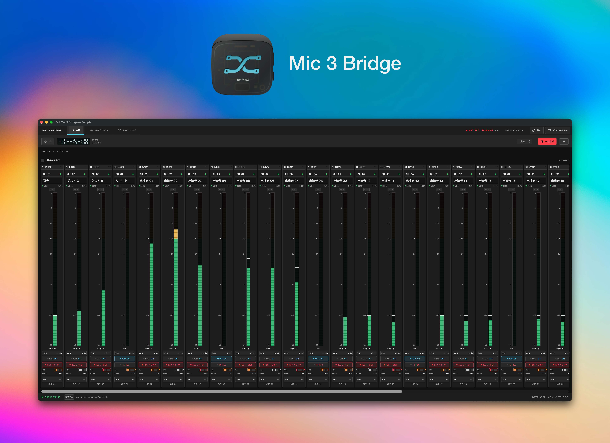

# DJI Mic 3 Bridge

複数のDJI Mic 3レシーバーをmacOSで使うためのアプリとCore Audioドライバーです。\
複数のレシーバーを本体シリアルで識別し、各レシーバーの音声を仮想入力へ送ります。

DAWなどの録音ソフトには、チャンネル数をあらかじめ固定した仮想入力「DJI Mic3 Matrix」を用意しています。\
仮想入力では入力ごとにレシーバーとチャンネルを割り当て、USBを抜き差ししても割り当てを保持します。\
切断中のチャンネルは無音を生成します。

※このプロジェクトの対応・検証対象はDJI Mic 3です。\
開発者が初代DJI Mic・DJI Mic 2・Mic Mini系を所有していないため、それらの対応・検証は行っていません。

## 開発のきっかけ

複数のDJI Mic 3レシーバーをMacへUSB接続して、まとめて収録したかったのがきっかけです。\
使っているソフトではレシーバーが同じ名前で表示され、片方しか選べないことがありました。\
macOSの「機器セット」も試しましたが、USBを抜き差しした後の再接続がうまくいきませんでした。

ポートやハブを変えても同じ入力に戻り、DAW側のチャンネル割り当てを保ったまま使えるようにしたくて、このアプリとドライバーを作りました。\
多人数の収録を想定し、複数マイクの状態確認や録音・TCの一括操作もMacから行えるようにしています。

## 主な機能

- 複数レシーバーの入力レベルと接続状態を表示し、バッテリーとストレージ残量も確認
- マイクごとのゲイン、ミュート、ノイズキャンセリング、EQ、Low Cutを操作
- Macと送信機本体の録音を一括操作し、送信機ごとの録音も個別に操作
- TCの一括設定とMac時刻への同期、録音中の波形表示
- 人物ラベルの設定と、録音を止めずに行うマイク間のラベル移動
- チャンネルを左詰めで表示し、横スクロールと未接続チャンネルの表示切替に対応

## インストール

macOS 14以降のApple Silicon／Intel Macで使えます。\
[Releases](https://github.com/SanMurakami/mic3-bridge/releases/latest) から `Mic3Bridge-*-universal.pkg` をダウンロードしてください。\
アプリとドライバーを同梱しているため、Xcodeやビルド作業は不要です。

録音を終了し、DJI Mic 3 Bridgeと音声を使用するアプリを閉じてから、pkgを開いてインストールしてください。\
導入には管理者認証が必要です。\
Core Audioが再起動するため、ほかの音声アプリも一時的に切断されます。\
完了後は「アプリケーション」からDJI Mic 3 Bridgeを開き、初回起動時にマイクへのアクセスを許可してください。

配布ファイルにはDeveloper ID署名とAppleの公証が付いていません。\
macOSにブロックされた場合は、配布元を確認したうえで「システム設定 → プライバシーとセキュリティ → このまま開く」から許可してください。\
詳しくは [Appleの説明](https://support.apple.com/ja-jp/102445) を参照してください。

リリース用ファイルは [GitHub Actions](https://github.com/SanMurakami/mic3-bridge/actions/workflows/build.yml) で生成し、Apple Silicon／Intelの両環境でテストしています。\
SHA-256チェックサムとGitHubのビルド証明も公開しています。\
実機での動作確認はApple Silicon Macで行っています。

レシーバーをUSB接続するとアプリに表示されます。\
DAW側で「DJI Mic3 Matrix」を入力に選び、アプリの「ルーティング」で割り当てを設定します。

削除する場合は、このリポジトリをダウンロードして `Uninstall.command` を実行してください。

## 録音とTC

Mac側の録音はレシーバーごとに4chのCAFファイルへ保存します。\
人物ラベルと録音中のラベル変更は、音声ファイルに付随するJSONへ記録します。\
送信機本体の録音はMac側の録音とは独立しています。

USBで音声を取り込むときは、TC出力を **N/A** に設定してください。\
**L-OUTではUSBの全4chがTC信号になり、音声を取り込めません。**\
A-OUTではCH1がTC信号になります。

## 開発

ソースからのビルドにはXcodeまたはCommand Line Toolsが必要です。

```sh
bash scripts/build.sh
bash scripts/test.sh
bash scripts/package.sh
```

`build.sh` はアプリとドライバーを `.build/` に生成し、ad-hoc署名を付けます。\
`test.sh` はドライバー、パケット処理、録音、ルーティングなどのテストを実行します。\
`package.sh` は両アーキテクチャをビルドし、インストーラーを `.build/release/` に生成します。

ソースから直接インストールする場合は `./Install.command` を実行してください。\
アプリだけを更新する `./Install.command --app-only` では、Core Audioを再起動しません。

`v0.11.0` のようにアプリのバージョンと一致するタグをpushすると、Actionsがビルド・テスト後にReleaseを公開します。

サードパーティーライセンスは [vendor/apple-null-audio/LICENSE.txt](vendor/apple-null-audio/LICENSE.txt) に記載しています。
